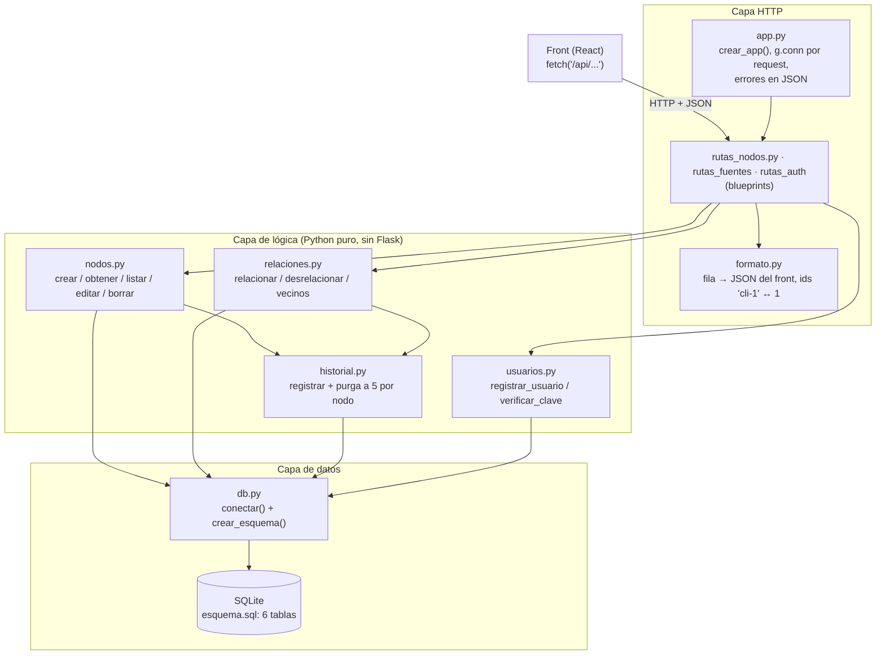
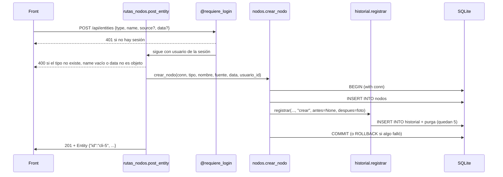

# Backend de Knowledge System — documentación completa

Qué se hizo en el backend (`back/`), cómo está armado y cómo funciona cada pieza. Está escrito para
quien no escribió el código: el resto del grupo, el que integra el front y quien lo corrija.

- **Para conectar el front** (rutas, ids, errores, `api.ts`): [`docs/INTEGRACION.md`](INTEGRACION.md).
- **Modelo de datos** (DER y tablas): [`docs/der.drawio.png`](der.drawio.png) y [`docs/modelo_relacional.md`](modelo_relacional.md).
- **Prueba de humo**: [`docs/prueba-humo.md`](prueba-humo.md). **Registro de cambios**: [`CAMBIOS.md`](../CAMBIOS.md).
- **Plan de tareas**: [`TAREAS.md`](../TAREAS.md); fichas de A en `tareas/A-archivo/` (todas terminadas), de Oziel en `tareas/B/` (la carpeta conserva su nombre).

Estado al **15/10/2026** (base firme): 46 tests en verde (`pytest back -q`) y la prueba de punta a punta
`python3 back/probar_a.py` termina en `TODO OK`.

---

## 1. Qué es y con qué está hecho

El front (repo `NickSPC/Knowledge-System`, React + TypeScript) muestra **entidades** (Clientes, Productos,
Pedidos), las **relaciones** entre ellas como un grafo y las **fuentes** de donde salieron los datos.
Hasta ahora leía datos inventados (`src/mocks/data.ts`). Este backend guarda todo eso en una base
**SQLite** y lo sirve con una API **HTTP/JSON** hecha en **Flask**, con exactamente la forma que espera
el front (`src/types.ts`).

| Pieza | Herramienta | Por qué |
|---|---|---|
| Base de datos | SQLite (módulo `sqlite3` de Python) | Un solo archivo, sin servidor; alcanza para el prototipo. |
| API | Flask 3 (`requirements.txt`: `flask`, `pytest`) | Simple, con blueprints y `test_client()` para probar sin levantar servidor. |
| Claves | `werkzeug.security` (viene con Flask) | Guarda solo el hash, nunca la clave. |
| Tests | pytest, base en memoria (`:memory:`) | Cada test arranca con una base limpia en milisegundos. |

## 2. Cómo levantarlo

```bash
# desde la raíz del repo
python3 -m venv .venv && source .venv/bin/activate
pip install -r back/requirements.txt
cd back
python3 semilla.py base.db     # crea base.db con los datos de los mocks (se puede repetir)
flask --app app run             # → http://localhost:5000
```

Verificar: `pytest back -q` (desde la raíz) y `python3 back/probar_a.py` (tiene que decir `TODO OK`).
Usuario de prueba de la semilla: `prueba@local` / `prueba123` (rol `admin`).

## 3. Cómo está armado (capas)

El código está en cuatro capas. Cada una solo usa la de abajo, así se puede probar cada capa por separado:



- **Capa de datos** (`esquema.sql`, `db.py`): las tablas y la conexión. Las reglas importantes viven en la
  base misma (claves foráneas, `UNIQUE`, `CHECK`), así no se pueden saltear desde el código.
- **Capa de lógica** (`nodos.py`, `relaciones.py`, `historial.py`, `usuarios.py`): funciones que reciben una
  conexión y trabajan con ids enteros. No saben nada de HTTP ni del formato del front.
- **Capa HTTP** (`app.py`, `rutas_*.py`, `formato.py`): recibe el JSON del front, lo valida, llama a la lógica
  y devuelve el JSON del front. Acá se traducen los ids (`"cli-1"` ↔ `1`) y los errores a códigos HTTP.

### Recorrido de un pedido: crear una entidad



La misma idea vale para editar, borrar, relacionar y desrelacionar: **el cambio y su línea de historial
se guardan en la misma transacción** (`with conn:`). Si algo falla a mitad, no queda nada a medias.

## 4. Decisiones de diseño (y por qué)

1. **Ids enteros en la base, texto en el front.** La base usa `INTEGER PRIMARY KEY`; el front espera
   `"cli-1"`, `"pro-5"`, `"ped-9"`. La traducción se hace **solo** en `formato.id_front()` / `formato.id_base()`.
   Un prefijo que no corresponde al tipo (`pro-1` para un Cliente) da 404.
2. **Grafo genérico.** Clientes, productos y pedidos son todos **nodos** de una misma tabla, con un
   `tipo_id` y un `contenido` JSON libre (`CHECK(json_valid(contenido))`). Agregar un tipo nuevo es una fila
   en `tipos_nodo`, no una tabla nueva.
3. **Relaciones sin repetidos ni lazos.** `UNIQUE(origen, destino, tipo)` y `CHECK(origen <> destino)` en la
   base; la API lo traduce a **409**.
4. **Borrado lógico.** Borrar marca `borrado = 1`: la entidad y sus relaciones dejan de aparecer en todas las
   rutas (igual que el mock), pero la fila y su historial quedan.
5. **Historial corto.** Cada `crear`, `editar`, `borrar`, `relacionar` y `desrelacionar` guarda una foto del
   "antes" y el "después". Se conservan los **últimos 5 por nodo** (`HISTORIAL_MAX`). Una relación cambia
   dos nodos, así que se anota en el historial de los dos.
6. **Errores siempre en JSON.** `app.py` convierte cualquier error en `{"error": "mensaje en español"}` con su
   código HTTP. El front nunca recibe una página HTML de error.
7. **Escrituras con login, lecturas libres.** POST/PUT/DELETE pasan por `@requiere_login` (401 sin sesión);
   los GET no piden login. La sesión es una cookie firmada de Flask (`SECRET_KEY`).
8. **Copias provisionales.** Mientras Oziel no sube `rutas_auth.py` (T29/T30), `rutas_fuentes.py` (T28) y T34,
   A dejó copias `*_provisional.py` para poder probar todo. `app.py` usa el archivo real si existe y la copia
   si no: cuando Oziel sube el suyo, se usa el de Oziel sin tocar nada más.

## 5. Quién hizo qué

**A = LDev (Lautaro)** · **Compañero: Oziel** (GitHub Ozis02). Las tareas de A están todas terminadas (23 fichas).

| Archivo | Autor | Tareas |
|---|---|---|
| `esquema.sql` | A (tablas de Oziel: `usuarios`, `historial`) | T06, T07, T08 (A); T09, T10 (Oziel) |
| `db.py` | A | T13 |
| `consultas.sql` | A | T12 |
| `nodos.py` | A | T15, T16, T22 |
| `relaciones.py` | A | T17, T22b |
| `rutas_nodos.py` | A | T26, T27, T31, T32, T33 (+ T34 provisional) |
| `rutas_fuentes_provisional.py` | A (copia de la tarea de Oziel) | T28 provisional |
| `rutas_auth_provisional.py` | A (copia de la tarea de Oziel) | T29/T30 provisional |
| `tests/test_historial.py`, `test_usuarios.py` | A | T24 |
| `tests/test_api_auth.py` | A | T36 |
| `probar_a.py` | A | prueba de punta a punta |
| `app.py` | Oziel (A agregó el uso de provisionales) | T25 |
| `formato.py` | Oziel | T19 |
| `historial.py` | Oziel | T20, T21 |
| `usuarios.py` | Oziel | T23 |
| `semilla.py` | Oziel | T11 |
| `tests/conftest.py`, `test_vacio.py` | Oziel | T14 |
| `tests/test_nodos.py`, `test_relaciones.py` | Oziel | T18 |

Además A hizo: el DER y el modelo relacional (T02), el entorno (T05), las dudas para el front (T01),
la guía de integración (`docs/INTEGRACION.md`, para T37) y la prueba de humo del back (T39).

**Lo que falta (no es de A):** que Oziel suba sus archivos reales (`rutas_auth.py`, `rutas_fuentes.py`, T34) y sus
tests de las rutas de A (T35); conectar el front (T37, lado del front); pasada final de humo con el front
(T39) y respaldo "base firme" conjunto (T40).

---

## 6. Base de datos: esquema, consultas y conexión

### `back/esquema.sql`

#### Tablas y relaciones

1. **`tipos_nodo`**
   - **Propósito**: Catálogo de tipos de entidades (ej. Cliente, Producto, Pedido).
   - **Uso**: Referenciado por `nodos.tipo_id` para definir el tipo de cada entidad.
   - **Estructura**:
     - `id`: Clave primaria autoincremental.
     - `nombre`: Texto único y obligatorio (ej. "Cliente").
   - **Detalles**:
     - No tiene restricciones adicionales.
     - Ejemplo de uso: `INSERT INTO tipos_nodo (nombre) VALUES ('Cliente');`

2. **`fuentes`**
   - **Propósito**: Registro de orígenes de datos (ej. CRM, ERP, CSV).
   - **Uso**: Referenciado por `nodos.fuente_id` para rastrear la procedencia de cada entidad.
   - **Estructura**:
     - `id`: Clave primaria autoincremental.
     - `nombre`: Texto único y obligatorio (ej. "Sistema CRM").
     - `tipo`: Texto obligatorio (ej. "CRM").
     - `estado`: Texto obligatorio con valores válidos: "ok" o "error".
     - `ultima_sync`: Texto en formato ISO o NULL (valida fechas con `datetime(ultima_sync) IS NOT NULL`).
   - **Detalles**:
     - `estado` y `ultima_sync` tienen validaciones con `CHECK`.
     - Ejemplo de uso: `INSERT INTO fuentes (nombre, tipo, estado) VALUES ('Sistema ERP', 'ERP', 'ok');`

3. **`usuarios`**
   - **Propósito**: Almacenamiento de cuentas de usuario para autenticación.
   - **Uso**: Referenciado por `nodos.creado_por` y `historial.usuario_id`.
   - **Estructura**:
     - `id`: Clave primaria.
     - `email`: Texto único y obligatorio (ej. "usuario@ejemplo.com").
     - `nombre`: Texto opcional (ej. "Juan Pérez").
     - `hash_clave`: Texto obligatorio (hash de la contraseña).
     - `rol`: Texto obligatorio con valores válidos: "admin", "editor" o "lector".
     - `creado`: Texto en formato ISO con valor por defecto `datetime('now')`.
   - **Detalles**:
     - `rol` tiene validación con `CHECK`.
     - Ejemplo de uso: `INSERT INTO usuarios (email, hash_clave, rol) VALUES ('admin@ejemplo.com', 'hash123', 'admin');`

4. **`nodos`**
   - **Propósito**: Entidades principales del grafo (ej. clientes, productos, pedidos).
   - **Uso**: Referenciado por `relaciones.origen_id`, `relaciones.destino_id` y `historial.nodo_id`.
   - **Estructura**:
     - `id`: Clave primaria.
     - `tipo_id`: Entero obligatorio (FK a `tipos_nodo.id`).
     - `fuente_id`: Entero obligatorio (FK a `fuentes.id`).
     - `creado_por`: Entero opcional (FK a `usuarios.id`).
     - `titulo`: Texto obligatorio (ej. "Pedido #1001").
     - `contenido`: Texto obligatorio con valor por defecto `'{}'` y validación `json_valid(contenido)`.
     - `creado_en`: Texto en formato ISO con valor por defecto `datetime('now')`.
     - `actualizado_en`: Texto en formato ISO o NULL.
     - `borrado`: Entero obligatorio con valor por defecto `0` y validación `CHECK (borrado IN (0, 1))`.
   - **Detalles**:
     - `borrado` implementa borrado lógico (1 = borrado).
     - `contenido` debe ser un JSON válido.
     - Ejemplo de uso: `INSERT INTO nodos (tipo_id, fuente_id, titulo, contenido) VALUES (1, 1, 'Cliente A', '{"dni": "12345678"}');`

5. **`relaciones`**
   - **Propósito**: Conexiones entre nodos (ej. "compró", "contiene").
   - **Uso**: Referenciado por `historial.relacion_id`.
   - **Estructura**:
     - `id`: Clave primaria.
     - `origen_id`: Entero obligatorio (FK a `nodos.id`).
     - `destino_id`: Entero obligatorio (FK a `nodos.id`).
     - `tipo`: Texto obligatorio (ej. "compró").
   - **Detalles**:
     - Restricciones: `UNIQUE (origen_id, destino_id, tipo)` (sin duplicados) y `CHECK (origen_id <> destino_id)` (sin lazos).
     - Ejemplo de uso: `INSERT INTO relaciones (origen_id, destino_id, tipo) VALUES (1, 2, 'compró');`

6. **`historial`**
   - **Propósito**: Registro de cambios en nodos y relaciones.
   - **Uso**: Consultado para mostrar el historial de cambios.
   - **Estructura**:
     - `id`: Clave primaria.
     - `nodo_id`: Entero obligatorio (FK a `nodos.id`).
     - `usuario_id`: Entero obligatorio (FK a `usuarios.id`).
     - `relacion_id`: Entero opcional (FK a `relaciones.id` con `ON DELETE SET NULL`).
     - `accion`: Texto obligatorio con valores válidos: "crear", "editar", "borrar", "relacionar", "desrelacionar".
     - `antes`: Texto opcional con validación `json_valid(antes)`.
     - `despues`: Texto opcional con validación `json_valid(despues)`.
     - `fecha`: Texto en formato ISO con valor por defecto `datetime('now')`.
   - **Detalles**:
     - Índice `idx_historial_nodo_fecha` en `(nodo_id, fecha)` para optimizar consultas.
     - Ejemplo de uso: `INSERT INTO historial (nodo_id, usuario_id, accion) VALUES (1, 1, 'crear');`

### `back/consultas.sql`

#### Consultas de práctica

1. **Nodos con el nombre de su tipo**
   - **Propósito**: Listar nodos junto con el nombre de su tipo.
   - **Consulta**:
     ```sql
     SELECT n.id, n.titulo, t.nombre AS tipo
     FROM nodos n
     JOIN tipos_nodo t ON t.id = n.tipo_id
     WHERE n.borrado = 0
     ORDER BY n.id;
     ```
   - **Detalles**:
     - Usa `JOIN` para combinar `nodos` y `tipos_nodo`.
     - Filtra nodos no borrados (`borrado = 0`).
     - Ejemplo de uso (Python con `sqlite3`):
       ```python
       conn = conectar("back/base.db")  # de db.py: filas por nombre (fila["id"])
       cursor = conn.cursor()
       cursor.execute("SELECT n.id, n.titulo, t.nombre AS tipo FROM nodos n JOIN tipos_nodo t ON t.id = n.tipo_id WHERE n.borrado = 0 ORDER BY n.id;")
       resultados = cursor.fetchall()
       for fila in resultados:
           print(fila["id"], fila["titulo"], fila["tipo"])
       conn.close()
       ```

2. **Vecinos del nodo 2**
   - **Propósito**: Encontrar nodos conectados al nodo con ID 2.
   - **Consulta**:
     ```sql
     SELECT r.destino_id AS vecino_id, v.titulo, r.tipo
     FROM relaciones r
     JOIN nodos v ON v.id = r.destino_id
     WHERE r.origen_id = 2 AND v.borrado = 0
     UNION
     SELECT r.origen_id, v.titulo, r.tipo
     FROM relaciones r
     JOIN nodos v ON v.id = r.origen_id
     WHERE r.destino_id = 2 AND v.borrado = 0
     ORDER BY vecino_id;
     ```
   - **Detalles**:
     - Usa `UNION` para combinar resultados de ambas direcciones de la relación.
     - Filtra nodos no borrados.
     - En Python lo mismo lo hace `relaciones.vecinos(conn, 2)`. No hay una ruta HTTP de vecinos: el front
       arma el grafo con `GET /api/relationships`.

3. **Cantidad de nodos por tipo**
   - **Propósito**: Contar nodos agrupados por tipo.
   - **Consulta**:
     ```sql
     SELECT t.nombre AS tipo, COUNT(*) AS cantidad
     FROM nodos n
     JOIN tipos_nodo t ON t.id = n.tipo_id
     WHERE n.borrado = 0
     GROUP BY t.nombre
     ORDER BY t.nombre;
     ```
   - **Detalles**:
     - Usa `GROUP BY` para agrupar por tipo y `COUNT(*)` para contar nodos.
     - Ejemplo de uso (Python con `sqlite3`):
       ```python
       conn = conectar("back/base.db")  # de db.py: filas por nombre (fila["id"])
       cursor = conn.cursor()
       cursor.execute("SELECT t.nombre AS tipo, COUNT(*) AS cantidad FROM nodos n JOIN tipos_nodo t ON t.id = n.tipo_id WHERE n.borrado = 0 GROUP BY t.nombre ORDER BY t.nombre;")
       resultados = cursor.fetchall()
       for fila in resultados:
           print(fila["tipo"], fila["cantidad"])
       conn.close()
       ```

### `back/db.py`

#### Funciones

1. **`conectar(ruta)`**
   - **Propósito**: Abrir una conexión a la base de datos.
   - **Parámetros**:
     - `ruta`: Ruta del archivo de la base de datos o `:memory:` para memoria.
   - **Devuelve**: Objeto de conexión SQLite.
   - **Detalles**:
     - Configura `foreign_keys = ON` para habilitar restricciones de clave foránea.
     - Establece `row_factory = sqlite3.Row` para acceder a filas por nombre (`fila["titulo"]`).
     - Abre con `check_same_thread=False`, porque Flask puede atender el request en otro hilo.
     - **Siempre** conectar con esta función: con `sqlite3.connect()` a secas no se controlan las FK.
     - Ejemplo de uso:
       ```python
       conn = conectar("prueba.db")
       cursor = conn.cursor()
       cursor.execute("SELECT * FROM nodos;")
       resultados = cursor.fetchall()
       conn.close()
       ```

2. **`crear_esquema(conn)`**
   - **Propósito**: Crear las tablas en la base de datos.
   - **Parámetros**:
     - `conn`: Objeto de conexión SQLite.
   - **Devuelve**: Nada.
   - **Detalles**:
     - Lee `esquema.sql` (al lado de `db.py`) y lo ejecuta con `executescript`.
     - Se puede correr varias veces: todo usa `IF NOT EXISTS` y no borra datos.
     - Ejemplo de uso:
       ```python
       conn = conectar("prueba.db")
       crear_esquema(conn)
       conn.close()
       ```

### `docs/modelo_relacional.md`

#### Documentación adicional

- **Diagrama**: `docs/der.drawio` (exportado en `docs/der.drawio.png`).
- **Convenciones**:
  - Fechas en texto ISO (`2026-10-05T10:32:00`).
  - Los `id` son `INTEGER` en la base y se entregan como texto al front.
- **Resumen de relaciones**: Tabla con cardinalidades y significados.
- **Decisiones**:
  - `contenido` es JSON en texto para flexibilidad.
  - `recordCount` calculado para evitar desactualización.
  - Borrado lógico para preservar historial.
  - `PRAGMA foreign_keys = ON` necesario en cada conexión.
---

## 7. Lógica: nodos, relaciones, historial y usuarios

### nodos.py

**Propósito**: Gestiona la creación, modificación, listado y borrado de nodos en la base de datos. Los nodos representan entidades del sistema con un tipo, fuente, título y contenido JSON. Todos los cambios se registran en el historial dentro de la misma transacción para mantener consistencia.

**Quién lo usa**: `rutas_nodos.py` (rutas `/api/entities`) y `probar_a.py`. Las funciones no saben nada de login ni de HTTP: reciben el `usuario_id` (para el historial) y trabajan con ids **enteros** de la base, no con `"cli-1"`.

**Constante `SELECT_NODO`**: la consulta base que usan `obtener_nodo` y `listar_nodos`. Une `nodos` con `tipos_nodo` y `fuentes` y devuelve las columnas `id`, `tipo` (nombre del tipo), `fuente` (nombre de la fuente), `titulo` y `contenido` (texto JSON).

#### Funciones

**`_tipo_id(conn, tipo)`**
- **Qué hace**: Obtiene el ID de un tipo de nodo por su nombre.
- **Parámetros**:
  - `conn`: Conexión a SQLite
  - `tipo`: Nombre del tipo (tiene que coincidir con `tipos_nodo.nombre`: "Cliente", "Producto" o "Pedido")
- **Devuelve**: ID del tipo (int)
- **Errores**:
  - `ValueError` si el tipo no existe
- **Detalles**:
  - Consulta directa a la tabla `tipos_nodo`
  - No maneja transacciones (delega en el llamador)

**`_fuente_id(conn, fuente)`**
- **Qué hace**: Obtiene el ID de una fuente o la crea si no existe.
- **Parámetros**:
  - `conn`: Conexión a SQLite
  - `fuente`: Nombre de la fuente (ej: "Manual", "API")
- **Devuelve**: ID de la fuente (int)
- **Detalles**:
  - Si la fuente no existe, la crea con estado "ok" y tipo "Manual"
  - No maneja transacciones

**`_foto(fila)`**
- **Qué hace**: Convierte una fila de base de datos en formato para el historial.
- **Parámetros**:
  - `fila`: Resultado de una consulta a la tabla nodos
- **Devuelve**: Diccionario con estructura:
  ```python
  {
      "name": "Título del nodo",
      "type": "Tipo del nodo",
      "source": "Fuente del nodo",
      "data": {...}   # el contenido ya convertido de JSON a diccionario
  }
  ```
- **Detalles**: es la "foto" que se guarda como `antes`/`despues` en el historial. Usa las mismas claves que el front (`name`, `type`, `source`, `data`).

**`crear_nodo(conn, tipo, nombre, fuente, data, usuario_id)`**
- **Qué hace**: Crea un nuevo nodo y registra el cambio en el historial.
- **Parámetros**:
  - `conn`: Conexión a SQLite
  - `tipo`: Nombre del tipo ("Cliente", "Producto" o "Pedido")
  - `nombre`: Título del nodo
  - `fuente`: Nombre de la fuente (si no existe, se crea con `_fuente_id`)
  - `data`: Diccionario con contenido (se convierte a JSON)
  - `usuario_id`: ID del usuario que crea el nodo
- **Devuelve**: ID del nuevo nodo (int)
- **Errores**:
  - `ValueError` si el tipo no existe
  - `sqlite3.IntegrityError` por violación de constraints
- **Detalles**:
  - Transacción completa: crea el nodo y registra en historial
  - Ejemplo de uso:
    ```python
    conn = conectar("back/base.db")      # de db.py
    nodo_id = crear_nodo(conn, "Cliente", "Cliente X", "Manual", {"ciudad": "Córdoba"}, 1)
    ```
  - El contenido se guarda como JSON con `ensure_ascii=False`

**`obtener_nodo(conn, nodo_id)`**
- **Qué hace**: Obtiene un nodo por ID (solo si no está borrado).
- **Parámetros**:
  - `conn`: Conexión a SQLite
  - `nodo_id`: ID del nodo
- **Devuelve**: una fila `sqlite3.Row` (se lee como `fila["titulo"]`) con las columnas de `SELECT_NODO`, o `None` si no existe **o está borrado**
- **Detalles**:
  - Usa la consulta `SELECT_NODO` con filtro por ID y `borrado = 0`
  - Para pasarla al JSON del front: `formato.a_entity(fila)`

**`listar_nodos(conn, tipo=None)`**
- **Qué hace**: Lista todos los nodos no borrados.
- **Parámetros**:
  - `conn`: Conexión a SQLite
  - `tipo`: Filtro opcional por tipo de nodo
- **Devuelve**: Lista de filas `sqlite3.Row` (mismas columnas que `obtener_nodo`); los borrados no aparecen
- **Detalles**:
  - Ordena por ID ascendente
  - Ejemplo con filtro:
    ```python
    pedidos = listar_nodos(conn, "Pedido")
    ```

**`editar_nodo(conn, nodo_id, usuario_id, nombre=None, data=None, tipo=None)`**
- **Qué hace**: Modifica un nodo existente.
- **Parámetros**:
  - `conn`: Conexión a SQLite
  - `nodo_id`: ID del nodo a editar
  - `usuario_id`: ID del usuario que edita
  - `nombre`: Nuevo título (opcional)
  - `data`: Nuevo contenido (opcional)
  - `tipo`: Nuevo tipo (opcional)
- **Devuelve**: `True` si se editó, `False` si el nodo no existe
- **Errores**:
  - `ValueError` si el nuevo tipo no existe
- **Detalles**:
  - Transacción completa: actualiza el nodo y registra en historial
  - Solo actualiza los campos proporcionados (usa valores anteriores si no se pasan). Por eso un PUT sin `data` conserva los datos.
  - Un nodo borrado cuenta como inexistente (devuelve `False`)
  - El historial guarda la foto de antes y la de después
  - Ejemplo:
    ```python
    editar_nodo(conn, 5, 2, nombre="Nuevo nombre", data={"campo": "valor"})
    ```

**`borrar_nodo(conn, nodo_id, usuario_id)`**
- **Qué hace**: Realiza borrado lógico (marca `borrado = 1`).
- **Parámetros**:
  - `conn`: Conexión a SQLite
  - `nodo_id`: ID del nodo a borrar
  - `usuario_id`: ID del usuario que borra
- **Devuelve**: `True` si se borró, `False` si el nodo no existe
- **Detalles**:
  - Transacción completa: marca como borrado y registra en historial
  - No elimina físicamente de la base: la fila y su historial quedan, pero deja de aparecer en `obtener_nodo`, `listar_nodos`, `vecinos` y en todas las rutas (sus relaciones también se ocultan)

### relaciones.py

**Propósito**: Gestiona las conexiones entre nodos. Cada relación tiene un tipo y se registra en el historial de ambos nodos afectados.

**Quién lo usa**: `rutas_nodos.py` (rutas `/api/relationships`) y `probar_a.py`. Igual que `nodos.py`: ids enteros y `usuario_id` como parámetro.

#### Funciones

**`_foto(origen, destino, tipo)`**
- **Qué hace**: Formatea los datos de una relación para el historial.
- **Parámetros**:
  - `origen`: ID del nodo origen
  - `destino`: ID del nodo destino
  - `tipo`: Tipo de relación
- **Devuelve**: Diccionario con estructura:
  ```python
  {
      "sourceId": "1",    # id ENTERO de la base pasado a texto (no "cli-1")
      "targetId": "2",
      "type": "asociado"
  }
  ```

**`relacionar(conn, origen, destino, tipo, usuario_id)`**
- **Qué hace**: Crea una relación entre dos nodos.
- **Parámetros**:
  - `conn`: Conexión a SQLite
  - `origen`: ID del nodo origen
  - `destino`: ID del nodo destino
  - `tipo`: Tipo de relación
  - `usuario_id`: ID del usuario que crea la relación
- **Devuelve**: ID de la nueva relación
- **Errores**:
  - `sqlite3.IntegrityError` si la relación ya existe (`UNIQUE`), si es un lazo (`origen == destino`, `CHECK`) o si algún nodo no existe (FK). La ruta lo traduce a 409/404.
- **Detalles**:
  - Transacción completa: crea la relación y registra `relacionar` en el historial de **los dos** nodos (antes `None`, después la foto)
  - Ejemplo:
    ```python
    relacion_id = relacionar(conn, 1, 2, "asociado", 1)
    ```

**`desrelacionar(conn, origen, destino, tipo, usuario_id)`**
- **Qué hace**: Elimina una relación existente.
- **Parámetros**:
  - `conn`: Conexión a SQLite
  - `origen`: ID del nodo origen
  - `destino`: ID del nodo destino
  - `tipo`: Tipo de relación a eliminar
  - `usuario_id`: ID del usuario que la borra
- **Devuelve**: `True` si se eliminó, `False` si no existía
- **Detalles**:
  - El borrado de la relación es **real** (`DELETE`), a diferencia de los nodos
  - Transacción completa: elimina la relación y registra `desrelacionar` en el historial de los dos nodos (antes la foto, después `None`). Si no existía, no anota nada
  - Ejemplo:
    ```python
    desrelacionar(conn, 1, 2, "asociado", 1)
    ```

**`vecinos(conn, nodo_id)`**
- **Qué hace**: Obtiene todos los nodos conectados a un nodo específico.
- **Parámetros**:
  - `conn`: Conexión a SQLite
  - `nodo_id`: ID del nodo a consultar
- **Devuelve**: Lista de filas `sqlite3.Row` con `vecino_id`, `titulo` y `tipo` (el de la relación)
- **Detalles**:
  - Incluye relaciones donde el nodo es origen o destino
  - Solo devuelve nodos no borrados
  - Ordena por `vecino_id`

### historial.py

**Propósito**: Registra y consulta el historial de cambios de los nodos, manteniendo un máximo de 5 registros por nodo.

#### Constantes
- `HISTORIAL_MAX = 5`: Número máximo de registros por nodo
- `ACCIONES`: Tipos de acciones permitidas: `("crear", "editar", "borrar", "relacionar", "desrelacionar")`

#### Funciones

**`_a_json(valor)`**
- **Qué hace**: Convierte un valor a JSON o `None`.
- **Parámetros**:
  - `valor`: Valor a convertir
- **Devuelve**: `None` si el valor es `None`, JSON string si no

**`_purgar(conn, nodo_id)`**
- **Qué hace**: Elimina registros antiguos de un nodo, manteniendo solo los últimos `HISTORIAL_MAX`.
- **Parámetros**:
  - `conn`: Conexión a SQLite
  - `nodo_id`: ID del nodo a purgar
- **Detalles**:
  - Borra los de ese nodo que no estén entre los 5 más nuevos; no toca el historial de otros nodos
  - La llama `registrar` después de cada inserción

**`registrar(conn, nodo_id, usuario_id, accion, antes, despues)`**
- **Qué hace**: Registra un cambio en el historial.
- **Parámetros**:
  - `conn`: Conexión a SQLite
  - `nodo_id`: ID del nodo afectado
  - `usuario_id`: ID del usuario que realizó el cambio
  - `accion`: Tipo de acción (debe estar en `ACCIONES`)
  - `antes`: Estado anterior (diccionario o `None`)
  - `despues`: Estado nuevo (diccionario o `None`)
- **Devuelve**: ID del registro creado
- **Errores**:
  - `ValueError` si la acción no es válida
- **Detalles**:
  - **No hace commit** a propósito: lo hace quien la llama (`nodos.py`, `relaciones.py`) dentro de su `with conn:`, así el cambio y su historial se guardan juntos
  - `antes` y `despues` se guardan como texto JSON
  - Después de insertar purga ese nodo para dejar solo los últimos `HISTORIAL_MAX`
  - Ejemplo:
    ```python
    registrar(conn, 1, 1, "editar", {"name": "Viejo"}, {"name": "Nuevo"})
    ```

**`historial_de(conn, nodo_id)`**
- **Qué hace**: Obtiene el historial de un nodo.
- **Parámetros**:
  - `conn`: Conexión a SQLite
  - `nodo_id`: ID del nodo a consultar
- **Devuelve**: Lista de filas ordenadas del más nuevo al más viejo (`ORDER BY fecha DESC, id DESC`: si dos cambios tienen la misma fecha, gana el id más alto)
- **Detalles**:
  - Cada registro incluye: `id`, `usuario_id`, `accion`, `antes`, `despues`, `fecha`
  - `antes` y `despues` son JSON strings o `None`

### usuarios.py

**Propósito**: Gestiona la autenticación y registro de usuarios, almacenando solo hashes de contraseñas.

#### Constantes
- `ROLES`: Roles permitidos: `("admin", "editor", "lector")`

#### Funciones

**`_normalizar(email)`**
- **Qué hace**: Normaliza un email para comparación.
- **Parámetros**:
  - `email`: Email a normalizar
- **Devuelve**: Email en minúsculas y sin espacios

**`registrar_usuario(conn, email, nombre, clave, rol="editor")`**
- **Qué hace**: Crea un nuevo usuario.
- **Parámetros**:
  - `conn`: Conexión a SQLite
  - `email`: Email del usuario
  - `nombre`: Nombre completo
  - `clave`: Contraseña en texto plano
  - `rol`: Rol del usuario (default: "editor")
- **Devuelve**: ID del usuario creado
- **Errores**:
  - `ValueError` si la clave está vacía o el rol no existe
  - `sqlite3.IntegrityError` si el email ya existe
- **Detalles**:
  - La clave se hashea con `werkzeug.security`
  - Transacción propia
  - Ejemplo:
    ```python
    usuario_id = registrar_usuario(conn, "ana@example.com", "Ana", "secreto123")
    ```

**`verificar_clave(conn, email, clave)`**
- **Qué hace**: Verifica credenciales de un usuario.
- **Parámetros**:
  - `conn`: Conexión a SQLite
  - `email`: Email del usuario
  - `clave`: Contraseña en texto plano
- **Devuelve**: Diccionario con datos del usuario si las credenciales son válidas, `None` si no
- **Detalles**:
  - No devuelve la clave ni su hash
  - Ejemplo:
    ```python
    usuario = verificar_clave(conn, "ana@example.com", "secreto123")
    if usuario:
        print(f"Bienvenido {usuario['nombre']}")
    ```
---

## 8. API HTTP: app, rutas y formato

### `app.py`

**Propósito**: Configuración central de la aplicación Flask. Define la estructura básica de la API, manejo de conexiones a la base de datos y registro de rutas.

**Quién lo usa**: `flask --app app run` (busca `create_app`, un alias de `crear_app`), los tests (`crear_app(":memory:")`) y `probar_a.py`.

**Constantes**: `MODULOS_DE_RUTAS = ("rutas_nodos", "rutas_fuentes", "rutas_auth")` y `MENSAJES`, los textos en español por código HTTP (400, 401, 403, 404, 405, 409, 415, 500).

#### Funciones principales

1. **`crear_app(ruta_db="base.db")`**
   - **Propósito**: Crea y configura la aplicación Flask.
   - **Parámetros**:
     - `ruta_db`: Ruta del archivo de base de datos (por defecto "base.db").
   - **Devuelve**: Instancia de Flask configurada.
   - **Detalles**:
     - `SECRET_KEY` sale de la variable de entorno; si no está, usa `"dev-solo-para-desarrollo"` (**solo** para desarrollo: firma la cookie de sesión).
     - Al arrancar abre la base y corre `crear_esquema` (si la base es nueva, crea las tablas vacías, sin semilla).
     - **Una conexión por request**: `before_request` la deja en `g.conn` y `teardown_appcontext` la cierra. Las rutas usan siempre `g.conn`.
     - Con `":memory:"` (tests) hay **una sola conexión compartida** en `app.config["CONN"]`, porque una base en memoria desaparece al cerrarse; el test le puede cargar datos por ahí.
     - **Errores en JSON**: un `errorhandler(HTTPException)` convierte todo error HTTP (incluidos `abort(...)`, 404 de URL inexistente y 405) en `{"error": "..."}`. Si la ruta hizo `abort(409, "texto")` usa ese texto; si no, el de `MENSAJES`.
   - **Ejemplo de uso**:
     ```bash
     cd back && flask --app app run          # http://localhost:5000, usa back/base.db
     ```
     ```python
     app = crear_app(":memory:")             # en un test
     cliente = app.test_client()
     cliente.get("/api/entities").get_json()
     ```

2. **`_registrar_rutas(app)`**
   - **Propósito**: Registra los blueprints de rutas en la aplicación.
   - **Parámetros**:
     - `app`: Instancia de Flask.
   - **Detalles**:
     - Intenta importar cada módulo de `MODULOS_DE_RUTAS`.
     - Si el archivo no existe, usa `<nombre>_provisional.py` (las copias de A) y lo avisa en el log; si tampoco existe, sigue sin esas rutas.
     - Si el archivo existe pero **falla un import adentro**, el error no se tapa: la app no arranca y se ve el problema.
     - Registra el blueprint (`bp`) de cada módulo. Por eso, cuando Oziel suba `rutas_auth.py` o `rutas_fuentes.py`, se usan solos sin tocar nada.

### `rutas_nodos.py`

**Propósito**: Maneja operaciones CRUD para nodos (entidades) y relaciones en el sistema.

**Quién lo usa**: el front. Los GET no piden login; POST, PUT y DELETE pasan por `@requiere_login` (401 sin sesión).

**Constantes**: `TIPOS = ("Cliente", "Producto", "Pedido")` y `FUENTE_POR_DEFECTO = "Manual"`.

#### Rutas

1. **`GET /api/entities`**
   - **Propósito**: Obtiene la lista de entidades.
   - **Método**: GET
   - **Login**: No requerido.
   - **Parámetros**:
     - `type` (query, opcional): Tipo de entidad (ej: "Cliente").
   - **Respuesta**: JSON con lista de entidades.
   - **Ejemplo de respuesta**:
     ```json
     [
         {"id": "cli-1", "type": "Cliente", "name": "Acme S.A.", "source": "clientes_2025.xlsx",
          "data": {"email": "contacto@acme.com", "ciudad": "Córdoba"}},
         ...
     ]
     ```
   - **Errores**: ninguno propio. Un `type` que no existe devuelve `[]`. Las entidades borradas no aparecen.
   - **Ejemplo**: `curl "http://localhost:5000/api/entities?type=Producto"`

2. **`GET /api/entities/<entity_id>`**
   - **Propósito**: Obtiene una entidad por su ID.
   - **Método**: GET
   - **Login**: No requerido.
   - **Parámetros**:
     - `entity_id` (path): ID de la entidad (ej: "cli-1").
   - **Respuesta**: JSON con la entidad.
   - **Ejemplo de respuesta**:
     ```json
     {"id": "cli-1", "type": "Cliente", "name": "Acme S.A.", "source": "clientes_2025.xlsx",
      "data": {"email": "contacto@acme.com", "ciudad": "Córdoba"}}
     ```
   - **Errores**:
     - 404: Si la entidad no existe, está borrada, el id es inválido o **el prefijo no coincide con el tipo** (`pro-1` no encuentra al Cliente 1).

3. **`GET /api/entities/<entity_id>/history`**
   - **Propósito**: Obtiene el historial de cambios de una entidad.
   - **Método**: GET
   - **Login**: No requerido.
   - **Parámetros**:
     - `entity_id` (path): ID de la entidad.
   - **Respuesta**: JSON con lista de cambios.
   - **Ejemplo de respuesta**:
     ```json
     [
         {"accion": "editar", "usuario": "Usuario de prueba",
          "antes":   {"name": "Acme", "type": "Cliente", "source": "Manual", "data": {}},
          "despues": {"name": "Acme S.A.", "type": "Cliente", "source": "Manual", "data": {}},
          "fecha": "2026-10-15T15:30:00"},
         {"accion": "crear", "usuario": "Usuario de prueba", "antes": null, "despues": {...}, "fecha": "..."}
     ]
     ```
   - **Detalles**:
     - Es la copia **provisional** de A de la tarea T34 de Oziel; Oziel la puede reemplazar.
     - Máximo 5 cambios (los guarda así `historial.py`), del más nuevo al más viejo.
     - `accion`: `crear`, `editar`, `borrar`, `relacionar` o `desrelacionar`. `usuario` es el **nombre** del usuario (o `null`).
     - En `relacionar`/`desrelacionar`, `antes`/`despues` es `{"sourceId", "targetId", "type"}` con los ids **enteros** de la base pasados a texto (`"1"`, no `"cli-1"`).
   - **Errores**:
     - 404: Si la entidad no existe.

4. **`GET /api/relationships`**
   - **Propósito**: Obtiene todas las relaciones existentes.
   - **Método**: GET
   - **Login**: No requerido.
   - **Respuesta**: JSON con lista de relaciones.
   - **Ejemplo de respuesta**:
     ```json
     [
         {"sourceId": "cli-1", "targetId": "pro-5", "type": "compró"}
     ]
     ```
   - **Detalles**: usa `formato.SELECT_RELACION`; las relaciones donde alguna punta está borrada no aparecen. Ordenadas por id.

5. **`POST /api/entities`**
   - **Propósito**: Crea una nueva entidad.
   - **Método**: POST
   - **Login**: Requerido.
   - **Parámetros (JSON)**:
     - `type`: Tipo de entidad ("Cliente", "Producto" o "Pedido").
     - `name`: Nombre de la entidad.
     - `source`: Origen de la entidad (opcional, por defecto "Manual").
     - `data`: Diccionario de atributos (opcional).
   - **Respuesta**: 201 Created, JSON con la entidad creada.
   - **Ejemplo de entrada**:
     ```json
     {"type": "Cliente", "name": "Juan Pérez", "source": "Manual", "data": {"edad": 30}}
     ```
   - **Ejemplo de respuesta**:
     ```json
     {"id": "cli-15", "type": "Cliente", "name": "Juan Pérez", "source": "Manual", "data": {"edad": 30}}
     ```
   - **Errores**:
     - 400: Si el JSON es inválido, el tipo no es válido, el nombre está vacío, data no es objeto, o los valores de data no son válidos.
     - 401: Sin sesión iniciada.

6. **`PUT /api/entities/<entity_id>`**
   - **Propósito**: Actualiza una entidad existente.
   - **Método**: PUT
   - **Login**: Requerido.
   - **Parámetros (JSON)**: se valida igual que el POST (`_validar_entity`), así que `type` y `name` son **obligatorios**.
     - `type`: Tipo de la entidad. Si cambia, **cambia el prefijo del id** (`cli-3` → `pro-3`): usar el id que devuelve la respuesta.
     - `name`: Nuevo nombre.
     - `data`: Nuevos atributos (opcional). **Sin `data` se conservan los datos que tenía**; con `data` se reemplazan enteros.
     - `source`: se valida pero no se cambia (la fuente de una entidad no se edita).
   - **Respuesta**: JSON con la entidad actualizada.
   - **Ejemplo de entrada**:
     ```json
     {"type": "Cliente", "name": "Juan Pérez", "data": {"edad": 31}}
     ```
   - **Ejemplo de respuesta**:
     ```json
     {"id": "cli-15", "type": "Cliente", "name": "Juan Pérez", "source": "Manual", "data": {"edad": 31}}
     ```
   - **Errores**:
     - 401: Sin sesión iniciada.
     - 404: Si la entidad no existe (se chequea antes que el JSON).
     - 400: Los mismos casos que el POST.

7. **`DELETE /api/entities/<entity_id>`**
   - **Propósito**: Elimina una entidad.
   - **Método**: DELETE
   - **Login**: Requerido.
   - **Parámetros**:
     - `entity_id`: ID de la entidad a borrar.
   - **Respuesta**: 204 No Content.
   - **Errores**:
     - 401: Sin sesión iniciada.
     - 404: Si la entidad no existe o ya estaba borrada.
   - **Detalles**: borrado **lógico**. La entidad y sus relaciones dejan de aparecer en todas las rutas; la fila y su historial quedan.

8. **`POST /api/relationships`**
   - **Propósito**: Crea una nueva relación entre dos entidades.
   - **Método**: POST
   - **Login**: Requerido.
   - **Parámetros (JSON)**:
     - `sourceId`: ID de la entidad origen.
     - `targetId`: ID de la entidad destino.
     - `type`: Tipo de relación.
   - **Respuesta**: 201 Created, JSON con la relación creada.
   - **Ejemplo de entrada**:
     ```json
     {"sourceId": "cli-1", "targetId": "pro-5", "type": "compra"}
     ```
   - **Ejemplo de respuesta**:
     ```json
     {"sourceId": "cli-1", "targetId": "pro-5", "type": "compra"}
     ```
   - **Errores**:
     - 400: Si el JSON es inválido o el tipo está vacío.
     - 401: Sin sesión iniciada.
     - 404: Si sourceId o targetId no existe.
     - 409: Si la relación ya existe o el nodo intenta relacionarse consigo mismo.
   - **Detalles**: el orden de validación es JSON → `type` → ids. A `type` se le sacan los espacios de los bordes. El 409 sale del `sqlite3.IntegrityError` de la base (`UNIQUE` o `CHECK`). Queda anotado en el historial de las dos entidades.

9. **`DELETE /api/relationships`**
   - **Propósito**: Elimina una relación existente.
   - **Método**: DELETE
   - **Login**: Requerido.
   - **Parámetros (JSON)**:
     - `sourceId`: ID de la entidad origen.
     - `targetId`: ID de la entidad destino.
     - `type`: Tipo de relación.
   - **Respuesta**: 204 No Content.
   - **Ejemplo de entrada**:
     ```json
     {"sourceId": "cli-1", "targetId": "pro-5", "type": "compra"}
     ```
   - **Errores**:
     - 400: Si el JSON es inválido o el tipo está vacío.
     - 401: Sin sesión iniciada.
     - 404: Si sourceId o targetId no existe, o si la relación no existe.
   - **Detalles**: el borrado de relaciones es **real** (no lógico). Queda anotado en el historial de las dos entidades.
   - **Nota**: es un `DELETE` con cuerpo JSON. En `fetch` hay que mandar `headers: {"Content-Type": "application/json"}` y `body`.

#### Funciones auxiliares

1. **`_error(mensaje, codigo)`**
   - **Propósito**: Genera una respuesta de error JSON.
   - **Parámetros**:
     - `mensaje`: Mensaje de error.
     - `codigo`: Código HTTP.
   - **Devuelve**: Tupla (JSON, código).

2. **`_validar_entity(datos)`**
   - **Propósito**: Valida los datos de una entidad.
   - **Parámetros**:
     - `datos`: Diccionario con los datos de la entidad.
   - **Devuelve**: Mensaje de error o None si es válido.

3. **`_buscar(entity_id)`**
   - **Propósito**: Busca una entidad por su ID.
   - **Parámetros**:
     - `entity_id`: ID de la entidad.
   - **Devuelve**: Fila de la entidad o None si no existe.

### `rutas_fuentes_provisional.py`

**Propósito**: Maneja operaciones relacionadas con fuentes de datos (provisional).

**Quién lo usa**: el front (pantalla de inicio). Es la copia **provisional** de A de la tarea T28 de Oziel: cuando Oziel suba `rutas_fuentes.py`, `app.py` usa la suya.

#### Rutas

1. **`GET /api/sources`**
   - **Propósito**: Obtiene la lista de fuentes de datos.
   - **Método**: GET
   - **Login**: No requerido.
   - **Respuesta**: JSON con lista de fuentes.
   - **Ejemplo de respuesta**:
     ```json
     [
         {"id": 1, "name": "clientes_2025.xlsx", "type": "Excel", "status": "ok",
          "lastSync": "05/10/2026 10:32", "recordCount": 4}
     ]
     ```
   - **Detalles**:
     - `id` es un **número** (no texto como en las entidades), igual que en el mock.
     - `status` es `"ok"` o `"error"` (lo garantiza un `CHECK` en la tabla).
     - `recordCount` se **calcula** contando los nodos no borrados de esa fuente; no se guarda.
     - `lastSync`: en la base es ISO; la ruta lo da como `dd/mm/aaaa hh:mm`, igual que el mock. Si la fuente nunca se sincronizó, `""`.
     - Sin login, como los demás GET.

### `rutas_auth_provisional.py`

**Propósito**: Login con sesión por cookie. Es la copia **provisional** de A de T29/T30 (Oziel), para poder probar las rutas que escriben. Cuando Oziel suba `rutas_auth.py`, se usa la suya. Cómo enchufarla: `docs/INTEGRACION.md` §6.

**Cómo funciona la sesión**: al hacer login, Flask guarda `usuario_id` en `session`, una cookie firmada con `SECRET_KEY`. El navegador la manda sola en cada pedido (con el proxy de Vite, o `credentials: "include"` en `fetch`).

#### Rutas

1. **`POST /api/auth/login`**
   - **Propósito**: Inicia sesión de usuario.
   - **Método**: POST
   - **Parámetros (JSON)**:
     - `email`: Correo electrónico del usuario.
     - `password`: Contraseña del usuario.
   - **Respuesta**: JSON con datos del usuario.
   - **Ejemplo de entrada**:
     ```json
     {"email": "prueba@local", "password": "prueba123"}
     ```
   - **Ejemplo de respuesta**:
     ```json
     {"id": 1, "email": "prueba@local", "nombre": "Usuario de prueba", "rol": "admin"}
     ```
   - **Errores**:
     - 401 `{"error": "email o clave incorrectos"}`: el email no existe o la clave no coincide (no dice cuál de las dos, a propósito).
   - **Detalles**: el email no distingue mayúsculas ni espacios en los bordes (`usuarios._normalizar`). La respuesta nunca trae la clave ni su hash.
   - **Ejemplo con curl** (guardando la cookie):
     ```bash
     curl -c cookies.txt -H "Content-Type: application/json" \
          -d '{"email":"prueba@local","password":"prueba123"}' http://localhost:5000/api/auth/login
     curl -b cookies.txt -X DELETE -H "Content-Type: application/json" \
          -d '{"sourceId":"cli-1","targetId":"pro-5","type":"compró"}' http://localhost:5000/api/relationships
     ```

2. **`POST /api/auth/logout`**
   - **Propósito**: Cierra sesión de usuario.
   - **Método**: POST
   - **Respuesta**: 204 No Content. Borra toda la sesión. No pide login (cerrar una sesión que no existe no es un error).

3. **`GET /api/auth/me`**
   - **Propósito**: Obtiene información del usuario autenticado.
   - **Método**: GET
   - **Login**: Requerido.
   - **Respuesta**: JSON con datos del usuario.
   - **Ejemplo de respuesta**:
     ```json
     {"id": 1, "email": "prueba@local", "nombre": "Usuario de prueba", "rol": "admin"}
     ```
   - **Errores**:
     - 401: Si no hay sesión iniciada, o si el usuario de la sesión ya no existe en la base.
   - **Uso en el front**: al cargar la app, para saber si ya hay alguien logueado.

#### Decorador

1. **`@requiere_login`**
   - **Propósito**: Requiere autenticación para una ruta.
   - **Detalles**:
     - Si no hay sesión, devuelve 401 `{"error": "no autenticado"}` sin llegar a la ruta.
     - Si hay sesión, guarda el ID del usuario en `g.usuario_id`; las rutas lo pasan a la lógica para el historial.
     - `rutas_nodos.py` lo importa de `rutas_auth` y, si no existe, de `rutas_auth_provisional`.

### `formato.py`

**Propósito**: Convierte datos de la base de datos al formato JSON esperado por el front-end.

**Quién lo usa**: `rutas_nodos.py` y `rutas_fuentes_provisional.py`. Lo escribió Oziel (T19). Es el **único** lugar donde se traducen los ids.

**Constantes**: `PREFIJOS = {"Cliente": "cli", "Producto": "pro", "Pedido": "ped"}` y `SELECT_RELACION`, la consulta que arma las filas de `a_relationship` (con el tipo de cada punta y sin relaciones de nodos borrados).

#### Funciones

1. **`id_front(tipo, nodo_id)`**
   - **Propósito**: Convierte un ID de base a formato front-end.
   - **Parámetros**:
     - `tipo`: Tipo de nodo.
     - `nodo_id`: ID numérico del nodo.
   - **Devuelve**: ID en formato "prefijo-numero".
   - **Ejemplo**:
     ```python
     id_front("Cliente", 1)  # -> "cli-1"
     ```
   - **Detalles**: si aparece un tipo nuevo que no está en `PREFIJOS`, usa sus 3 primeras letras en minúscula.

2. **`id_base(texto)`**
   - **Propósito**: Convierte un ID de front-end a ID de base.
   - **Parámetros**:
     - `texto`: ID en formato "prefijo-numero".
   - **Devuelve**: ID numérico.
   - **Errores**:
     - ValueError: Si el formato es inválido.
   - **Ejemplo**:
     ```python
     id_base("cli-1")  # -> 1
     ```
   - **Detalles**: **no** controla el prefijo (`id_base("pro-1")` también da 1). Por eso `rutas_nodos._buscar` vuelve a armar el id con `id_front` y lo compara.

3. **`a_entity(fila)`**
   - **Propósito**: Convierte una fila de nodo a formato Entity.
   - **Parámetros**:
     - `fila`: Fila de la tabla nodos.
   - **Devuelve**: Diccionario con formato Entity.
   - **Ejemplo**:
     ```python
     a_entity({"id": 1, "tipo": "Cliente", "titulo": "Acme", "fuente": "Manual", "contenido": '{"email": "contacto@acme.com"}'})
     # -> {"id": "cli-1", "type": "Cliente", "name": "Acme", "source": "Manual", "data": {"email": "contacto@acme.com"}}
     ```

4. **`a_relationship(fila)`**
   - **Propósito**: Convierte una fila de relación a formato Relationship.
   - **Parámetros**:
     - `fila`: Fila con origen_id, origen_tipo, destino_id, destino_tipo, tipo.
   - **Devuelve**: Diccionario con formato Relationship.
   - **Ejemplo**:
     ```python
     a_relationship({"origen_id": 1, "origen_tipo": "Cliente", "destino_id": 5, "destino_tipo": "Producto", "tipo": "compra"})
     # -> {"sourceId": "cli-1", "targetId": "pro-5", "type": "compra"}
     ```
---

## 9. Datos de prueba, scripts y tests

Cómo correr todo (desde la raíz del repo):
```bash
.venv/bin/pytest back -q              # 46 tests, tiene que dar "46 passed"
.venv/bin/python back/probar_a.py     # prueba de punta a punta, tiene que terminar en "TODO OK"
```
`tests/test_vacio.py` (Oziel) es un test vacío que solo comprueba que pytest corre.

### semilla.py

**Autor**: Oziel (T11). **Propósito**: Script para cargar datos de prueba en la base de datos SQLite. Borra los datos existentes y los reemplaza con un conjunto predefinido de fuentes, nodos y relaciones, basado en los mocks del frontend.

**Uso**:
```bash
python semilla.py base.db
```

**Funciones principales**:

1. `vaciar(conn)`:
   - **Propósito**: Elimina todos los datos de las tablas en orden específico (hijas primero para evitar problemas con FK)
   - **Parámetros**: Conexión a la base de datos
   - **Detalles no obvios**:
     - Usa `DELETE FROM sqlite_sequence` para resetear los autoincrementales
     - Orden de tablas: `historial`, `relaciones`, `nodos`, `usuarios`, `fuentes`, `tipos_nodo`

2. `cargar(conn)`:
   - **Propósito**: Carga los datos predefinidos en la base
   - **Parámetros**: Conexión a la base de datos
   - **Detalles no obvios**:
     - Convierte los datos JSON a strings para almacenamiento
     - Usa transacciones para garantizar consistencia
     - Crea un usuario de prueba con clave hasheada

3. `contar(conn)`:
   - **Propósito**: Devuelve conteos de fuentes, nodos y relaciones
   - **Parámetros**: Conexión a la base de datos
   - **Devuelve**: Diccionario con los conteos

**Datos cargados**:
- 3 fuentes (Excel, SQL, Trello)
- 14 nodos (4 clientes, 4 productos, 6 pedidos)
- 15 relaciones entre nodos
- 1 usuario de prueba (admin)

**Validación**:
- Compara los conteos con los valores esperados definidos en `ESPERADO`

### probar_a.py

**Autor**: A. **Propósito**: Script de prueba manual de punta a punta de las tareas de A (T13 a T33). Crea una base temporal, carga la semilla y prueba las funciones y rutas.

**Uso**:
```bash
python3 back/probar_a.py
```

**Pruebas realizadas**:

1. **T13 - Creación del esquema**:
   - Verifica que se creen las 6 tablas esperadas
   - Prueba que las FK estén activas

2. **T15 - Creación y obtención de nodos**:
   - Crea un nodo nuevo y verifica que se pueda obtener
   - Prueba con ID inexistente

3. **T16 - Listado, edición y borrado de nodos**:
   - Verifica el listado de nodos
   - Prueba la edición de nodos
   - Verifica el borrado lógico

4. **T17 - Relaciones entre nodos**:
   - Prueba la creación y eliminación de relaciones
   - Verifica que no se permitan relaciones duplicadas o con el mismo nodo

5. **T22/T22b - Historial de cambios**:
   - Verifica que las operaciones queden registradas en el historial
   - Prueba el rollback cuando falla el registro

6. **T26 a T32 - API**:
   - Prueba las rutas de entidades y relaciones
   - Verifica el flujo de autenticación
   - Prueba operaciones CRUD completas

**Ejemplo de uso**:
```python
# Verificar que la creación de esquema funcione
ver("T13 crear_esquema crea las 6 tablas",
    {"tipos_nodo", "fuentes", "usuarios", "nodos", "relaciones", "historial"} <= tablas)
```

### tests/conftest.py

**Autor**: Oziel (T14). **Propósito**: Fixture para tests que proporciona una base de datos en memoria con datos mínimos predefinidos.

**Fixture `conn`**:
- **Propósito**: Proporciona una base en memoria nueva para cada test
- **Datos predefinidos**:
  - Tipo de nodo: 1 = Cliente
  - Fuente: 1 = "fuente de prueba"
  - Usuario: 1 = prueba@local
  - Nodos: 1 y 2 (ambos de tipo Cliente)
- **Detalles no obvios**:
  - Usa transacción para garantizar consistencia
  - IDs fijos para predecibilidad en tests

### tests/test_api_auth.py

**Propósito**: Tests para las rutas de autenticación de la API.

**Autor**: A (T36). **Casos** (7, uno por función; el nombre dice qué comprueba):
- `test_login_correcto`
- `test_login_clave_mala`
- `test_auth_me_flow`
- `test_post_entities_no_login`
- `test_get_sources`
- `test_historial_flow`
- `test_get_history_not_found`

**Ejemplo de uso**:
```python
def test_login_correcto(cliente):
    response = cliente.post("/api/auth/login", json={
        "email": semilla.USUARIO_PRUEBA["email"],
        "password": semilla.USUARIO_PRUEBA["clave"]
    })
    assert response.status_code == 200
```

### tests/test_historial.py

**Propósito**: Tests para el módulo de historial, incluyendo registro, purga y rollback.

**Autor**: A (T24). **Casos** (9, uno por función; el nombre dice qué comprueba):
- `test_registrar_y_leer`
- `test_registrar_accion_invalida_falla`
- `test_historial_del_mas_nuevo_al_mas_viejo`
- `test_tope_de_5_por_nodo_sin_tocar_otros`
- `test_crear_editar_borrar_quedan_en_el_historial`
- `test_relacionar_y_desrelacionar_en_los_dos_nodos`
- `test_rollback_si_falla_registrar_al_crear`
- `test_rollback_si_falla_registrar_al_editar`
- `test_rollback_si_falla_registrar_al_relacionar`

**Ejemplo de uso**:
```python
def test_registrar_y_leer(conn):
    with conn:
        registrar(conn, 1, 1, "editar", {"name": "viejo"}, {"name": "nuevo"})
    cambios = historial_de(conn, 1)
    assert len(cambios) == 1
    assert cambios[0]["accion"] == "editar"
```

### tests/test_nodos.py

**Propósito**: Tests para las operaciones CRUD de nodos.

**Autor**: Oziel (T18). **Casos** (15, uno por función; el nombre dice qué comprueba):
- `test_crear_nodo_funciona`
- `test_crear_nodo_con_tipo_inexistente_falla`
- `test_crear_nodo_con_fuente_nueva_la_crea`
- `test_la_base_rechaza_un_json_invalido`
- `test_la_base_rechaza_un_tipo_inexistente`
- `test_obtener_nodo_funciona`
- `test_obtener_nodo_inexistente_devuelve_none`
- `test_listar_nodos_funciona`
- `test_listar_nodos_de_un_tipo_sin_nodos_devuelve_vacio`
- `test_editar_nodo_funciona`
- `test_editar_nodo_sin_pasar_datos_no_cambia_el_resto`
- `test_editar_nodo_inexistente_devuelve_false`
- `test_editar_nodo_con_tipo_inexistente_falla_y_no_cambia_nada`
- `test_borrar_nodo_funciona_y_es_logico`
- `test_borrar_nodo_inexistente_o_ya_borrado_devuelve_false`

**Ejemplo de uso**:
```python
def test_crear_nodo_funciona(conn):
    nodo_id = crear_nodo(conn, "Cliente", "Nuevo S.A.", FUENTE, {"ciudad": "Mendoza"}, USUARIO)
    fila = obtener_nodo(conn, nodo_id)
    assert fila["titulo"] == "Nuevo S.A."
```

### tests/test_relaciones.py

**Propósito**: Tests para las operaciones de relaciones entre nodos.

**Autor**: Oziel (T18). **Casos** (10, uno por función; el nombre dice qué comprueba):
- `test_relacionar_funciona`
- `test_relacionar_un_duplicado_falla`
- `test_relacionar_los_mismos_nodos_con_otro_tipo_se_permite`
- `test_relacionar_un_nodo_consigo_mismo_falla`
- `test_relacionar_con_un_nodo_inexistente_falla`
- `test_desrelacionar_funciona`
- `test_desrelacionar_algo_que_no_existe_devuelve_false`
- `test_vecinos_funciona_de_los_dos_lados`
- `test_vecinos_de_un_nodo_sin_relaciones_devuelve_vacio`
- `test_vecinos_no_incluye_nodos_borrados`

**Ejemplo de uso**:
```python
def test_relacionar_funciona(conn):
    relacion_id = relacionar(conn, 1, 2, "conoce a", USUARIO)
    fila = conn.execute("SELECT * FROM relaciones WHERE id = ?", (relacion_id,)).fetchone()
    assert (fila["origen_id"], fila["destino_id"], fila["tipo"]) == (1, 2, "conoce a")
```

### tests/test_usuarios.py

**Propósito**: Tests para las operaciones de usuarios.

**Autor**: A (T24), sobre código de Oziel. **Casos** (4, uno por función; el nombre dice qué comprueba):
- `test_la_clave_no_se_guarda_en_texto_plano`
- `test_email_repetido_falla`
- `test_verificar_clave_buena`
- `test_verificar_clave_mala_o_email_inexistente`

**Ejemplo de uso**:
```python
def test_la_clave_no_se_guarda_en_texto_plano(conn):
    registrar_usuario(conn, "ana@local", "Ana", "secreta123")
    hash_clave = conn.execute("SELECT hash_clave FROM usuarios WHERE email = 'ana@local'").fetchone()[0]
    assert "secreta123" not in hash_clave
```
---
