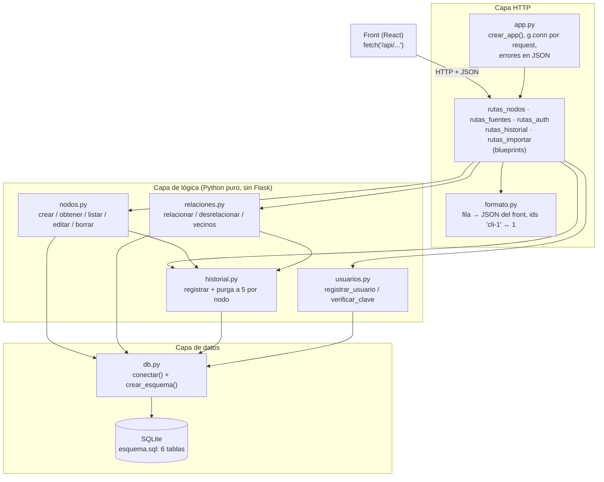
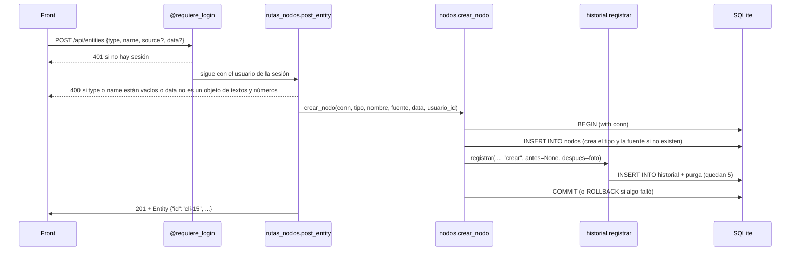

# Backend de Knowledge System — cómo está hecho

Qué hace el backend (`back/`), cómo está armado y por qué. Para usar la API (cada ruta con lo que recibe,
devuelve y sus errores) está [`INTEGRACION.md`](INTEGRACION.md); para las tablas,
[`modelo_relacional.md`](modelo_relacional.md) y el diagrama [`der.drawio.png`](der.drawio.png).

## 1. Qué es y con qué está hecho

El front (React + TypeScript) muestra **entidades** de cualquier tipo, las **relaciones** entre ellas como un
grafo y las **fuentes** de donde salieron los datos. Este backend guarda todo eso en una base **SQLite** y lo
sirve con una API **HTTP/JSON** hecha en **Flask**, con la forma que espera el front.

| Pieza | Herramienta | Por qué |
|---|---|---|
| Base de datos | SQLite (módulo `sqlite3` de Python) | Un solo archivo, sin servidor. |
| API | Flask (`back/requirements.txt`: `flask`, `pytest`) | Simple, con blueprints y `test_client()` para probar sin levantar servidor. |
| Claves | `werkzeug.security` (viene con Flask) | Guarda solo el hash, nunca la clave. |
| Tests | pytest, base en memoria (`:memory:`) | Cada test arranca con una base limpia. |

## 2. Cómo levantarlo y verificarlo

```bash
# desde la raíz del repo
python3 -m venv .venv && source .venv/bin/activate
pip install -r back/requirements.txt
cd back
python3 semilla.py base.db     # crea base.db con datos de ejemplo (se puede repetir)
flask --app app run             # → http://localhost:5000
```

Verificar (desde la raíz): `pytest back -q` (86 tests) y `python3 back/probar_a.py` (41 comprobaciones de punta a
punta; tiene que terminar en `TODO OK`). Usuario de la semilla: `prueba@local` / `prueba123` (rol `admin`).

## 3. Cómo está armado (capas)

Cada capa solo usa la de abajo, así se puede probar por separado:



- **Capa de datos** (`esquema.sql`, `db.py`): las tablas y la conexión. Las reglas importantes viven en la base
  misma (claves foráneas, `UNIQUE`, `CHECK`), así no se pueden saltear desde el código.
- **Capa de lógica** (`nodos.py`, `relaciones.py`, `historial.py`, `usuarios.py`): funciones que reciben una
  conexión y trabajan con ids enteros. No saben nada de HTTP ni del formato del front.
- **Capa HTTP** (`app.py`, `rutas_*.py`, `formato.py`): recibe el JSON, lo valida, llama a la lógica y devuelve
  el JSON del front. Acá se traducen los ids (`"cli-1"` ↔ `1`) y los errores a códigos HTTP.

### Recorrido de un pedido: crear una entidad



Lo mismo vale para editar, borrar, relacionar y desrelacionar: **el cambio y su línea de historial se guardan
en la misma transacción** (`with conn:`). Si algo falla a mitad, no queda nada a medias.

## 4. Decisiones de diseño (y por qué)

1. **Ids enteros en la base, texto en la API.** La base usa `INTEGER PRIMARY KEY`; la API entrega
   `"cli-1"`, `"pro-5"`, `"ped-9"`. La traducción se hace **solo** en `formato.id_front()` /
   `formato.id_base()`. Un prefijo que no corresponde al tipo (`pro-1` para un Cliente) da 404.
2. **Grafo genérico con tipos libres.** Todas las entidades son **nodos** de una misma tabla, con un `tipo_id`
   y un `contenido` JSON libre (`CHECK(json_valid(contenido))`). Un tipo nuevo es una fila en `tipos_nodo`, que
   se crea sola la primera vez que se usa.
3. **Relaciones sin repetidos ni lazos.** `UNIQUE(origen, destino, tipo)` y `CHECK(origen <> destino)` en la
   base; la API lo traduce a **409**.
4. **Borrado lógico de entidades.** Borrar marca `borrado = 1`: la entidad y sus relaciones dejan de aparecer
   en todas las rutas, pero la fila y su historial quedan. Borrar una fuente o vaciar los datos sí borra filas.
5. **Los ids de nodo no se reutilizan** (`AUTOINCREMENT`): si se reusaran tras borrar una fuente, un nodo nuevo
   heredaría el historial de otro. Una base creada antes de este cambio no lo recibe (`CREATE TABLE IF NOT
   EXISTS` no modifica tablas existentes): `app.py` lo detecta al arrancar y lo avisa en el log.
6. **Historial corto.** Cada `crear`, `editar`, `borrar`, `relacionar` y `desrelacionar` guarda una foto del
   "antes" y el "después". Se conservan los **últimos 5 por nodo** (`historial.HISTORIAL_MAX`). Una relación
   cambia dos nodos, así que se anota en el historial de los dos.
7. **Errores siempre en JSON.** `app.py` convierte cualquier error HTTP en `{"error": "mensaje"}` con su código.
8. **Escrituras con login, lecturas libres.** POST/PUT/DELETE pasan por `@requiere_login` (401 sin sesión); los
   GET no piden login. La sesión es una cookie firmada de Flask (`SECRET_KEY`).
9. **Importación todo o nada.** `POST /api/import` valida el archivo entero antes de tocar la base y guarda todo
   en una sola transacción; por eso no reutiliza `crear_nodo` / `relacionar`, que confirman cada una por su cuenta.

## 5. Archivos de `back/`

| Archivo | Qué hace |
|---|---|
| `esquema.sql` | Las 6 tablas: `tipos_nodo`, `fuentes`, `usuarios`, `nodos`, `relaciones`, `historial`. Se puede correr varias veces. |
| `db.py` | `conectar(ruta)` (con `foreign_keys = ON` y filas que se leen por nombre) y `crear_esquema(conn)`. |
| `app.py` | `crear_app(ruta_db)`: abre una conexión por request (`g.conn`), registra los blueprints, devuelve los errores como JSON y avisa si la base es de una versión anterior. |
| `formato.py` | Traduce filas de la base al JSON del front (`a_entity`, `a_relationship`) y los ids (`id_front`, `id_base`). |
| `nodos.py` | `crear_nodo`, `obtener_nodo`, `listar_nodos`, `editar_nodo`, `borrar_nodo` (borrado lógico). Cada cambio queda en el historial en la misma transacción. |
| `relaciones.py` | `relacionar`, `desrelacionar`, `vecinos`. Cada cambio queda en el historial de los dos nodos. |
| `historial.py` | `registrar` (guarda un cambio y deja solo los últimos 5 de ese nodo; no hace commit) e `historial_de`. |
| `usuarios.py` | `registrar_usuario` (guarda solo el hash de la clave), `verificar_clave` y `obtener_usuario`. |
| `rutas_auth.py` | `/api/auth/login`, `/logout`, `/me` y el decorador `requiere_login`, que deja `g.usuario_id` y `g.usuario`. |
| `rutas_nodos.py` | `/api/entities` y `/api/relationships`. |
| `rutas_historial.py` | `GET /api/entities/<id>/history` y `GET /api/history`. |
| `rutas_fuentes.py` | `GET /api/sources`. |
| `rutas_importar.py` | `POST /api/import`, `DELETE /api/data` y `DELETE /api/sources/<id>`. |
| `semilla.py` | Carga datos de ejemplo: 3 fuentes, 14 nodos, 15 relaciones y el usuario de prueba. `python semilla.py base.db` borra y recarga. |
| `consultas.sql` | Tres consultas de práctica sobre la semilla (JOIN, vecinos con UNION, conteo por tipo). No las usa la app. |
| `probar_a.py` | Prueba de punta a punta sobre una base temporal: funciones y rutas. |
| `tests/` | Tests de pytest (sección 7). |

Para agregar rutas: un archivo `rutas_*.py` que exponga un `Blueprint` llamado `bp`, sumado a
`MODULOS_DE_RUTAS` en `app.py`. Para pedir login, `@requiere_login` va **debajo** de `@bp.route`.

## 6. Levantar todo con un doble clic

En la raíz del repo están los lanzadores: `Iniciar (Windows).bat`, `iniciar.sh` y el acceso directo
`Knowledge System.desktop` (Linux). Los tres terminan en `iniciar.py`.

- `iniciar.py`: una sola app Flask sirve la API y el front compilado (`web/`), en `http://127.0.0.1:5001`
  (variable `PUERTO` para cambiarlo; `SIN_NAVEGADOR=1` para que no abra el navegador).
- La primera vez crea `datos/base.db` vacía con el usuario `prueba@local` / `prueba123` y una clave de sesión
  propia en `datos/clave-sesion.txt`. Los datos se cargan desde el front (Fuentes → Importar JSON).
- Una ruta `/api/...` que no existe responde 404 en JSON; cualquier otra ruta desconocida devuelve la página
  del front (es una aplicación de una sola página).
- `Iniciar (Windows).bat` e `iniciar.sh` crean el entorno virtual `.venv` e instalan `back/requirements.txt`
  si Flask no está (necesita internet esa única vez), y después llaman a `iniciar.py`.
- `web/` es el front ya compilado y está versionado para que alcance con Python. Si falta, `/` responde 404 con
  el aviso de cómo generarlo.
- `paquete/armar.sh <carpeta del front>` recompila el front (`npm run build`, necesita Node), reemplaza `web/` y
  arma `paquete/KnowledgeSystem.zip` (back sin tests, `web/`, lanzadores y `paquete/LEEME.txt`) para llevar a
  otra PC sin clonar el repo. El zip no se versiona.

## 7. Pruebas

```bash
.venv/bin/pytest back -q              # 86 passed
.venv/bin/python back/probar_a.py     # 41 líneas OK y "TODO OK"
```

| Archivo | Tests | Qué cubre |
|---|---|---|
| `tests/conftest.py` | — | Fixture `conn`: base en memoria con un tipo, una fuente, un usuario y dos nodos de ids fijos. |
| `tests/test_nodos.py` | 15 | Funciones de `nodos.py` y reglas del esquema. |
| `tests/test_relaciones.py` | 10 | `relacionar`, `desrelacionar`, `vecinos`. |
| `tests/test_historial.py` | 9 | Tope de 5 por nodo, los 5 tipos de cambio y rollback. |
| `tests/test_usuarios.py` | 4 | Alta de usuarios y verificación de clave. |
| `tests/test_api_auth.py` | 15 | Por HTTP: sesión, fuentes, historial y validaciones de entidades y relaciones. |
| `tests/test_api_nodos.py` | 18 | Por HTTP: entidades y relaciones (crear, editar, borrar, validaciones, sin login) e historial global. |
| `tests/test_api_importar.py` | 14 | Por HTTP: importar, vaciar, borrar fuentes, tipos libres, ids que no se reutilizan y aviso de base vieja. |
| `tests/test_vacio.py` | 1 | Que la fixture `conn` funciona. |
